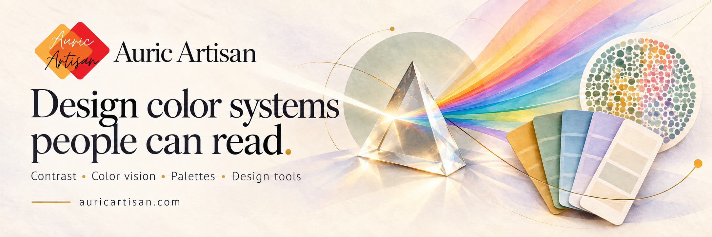

# Auric Artisan

**Color. Accessibility. Visual intelligence.**

Software for understanding color, evaluating interfaces, and turning visual ideas into practical work.

[Explore tools](https://auricartisan.com/collections/) &nbsp; · &nbsp; [Read the docs](https://github.com/auricartisan/Auric-Artisan-Docs) &nbsp; · &nbsp; [Organization profile](profile/README.md)

---

## A clearer view of color

Auric Artisan brings color science, accessibility analysis, and creative utilities into one platform. We build for designers choosing a palette, developers checking an interface, and curious people exploring how we see.

<table>
  <tr>
    <td width="50%" valign="top">
      <h3>01 &nbsp; Color systems</h3>
      
Explore color spaces, build palettes and gradients, and understand the relationships behind a visual system.

    </td>
    <td width="50%" valign="top">
      <h3>02 &nbsp; Accessible interfaces</h3>
      
Examine contrast, readability, and color-vision risks to make more informed design decisions.

    </td>
  </tr>
  <tr>
    <td width="50%" valign="top">
      <h3>03 &nbsp; Vision &amp; perception</h3>
      
Investigate how viewing conditions and visual perception affect the way color and content appear.

    </td>
    <td width="50%" valign="top">
      <h3>04 &nbsp; Creative workflows</h3>
      
Extract image palettes, recolor SVGs, and create visual assets you can take into your next project.

    </td>
  </tr>
</table>

## Start here

| If you want to… | Go to |
| :--- | :--- |
| Try the platform | [Browse the tools](https://auricartisan.com/collections/) |
| Learn how a product works | [Product documentation](https://github.com/auricartisan/Auric-Artisan-Docs) |
| Explore our work on GitHub | [Auric Artisan repositories](https://github.com/orgs/auricartisan/repositories) |
| Understand the project | [About Auric Artisan](https://auricartisan.com/company/about/) |
| Ask a question or share feedback | [Contact us](https://auricartisan.com/company/contact/) |

## Inside this repository

This is Auric Artisan's public `.github` repository, home to our organization profile and this introduction.

| File | Purpose |
| :--- | :--- |
| [README.md](README.md) | The landing page for this repository. |
| [profile/README.md](profile/README.md) | The profile displayed on the organization's GitHub overview. |
| [assets/auric-artisan-website-banner.png](assets/auric-artisan-website-banner.png) | The editable image at the top of this page. |

To update the organization profile, edit [profile/README.md](profile/README.md). When changing either README, preview it on GitHub and check that images, relative links, and destinations still work.

---

**Clear explanations. Thoughtful tools. Room to explore.**

[auricartisan.com](https://auricartisan.com/) &nbsp; · &nbsp; [LinkedIn](https://www.linkedin.com/company/auric-artisan/) &nbsp; · &nbsp; [X](https://x.com/auricartisan)

